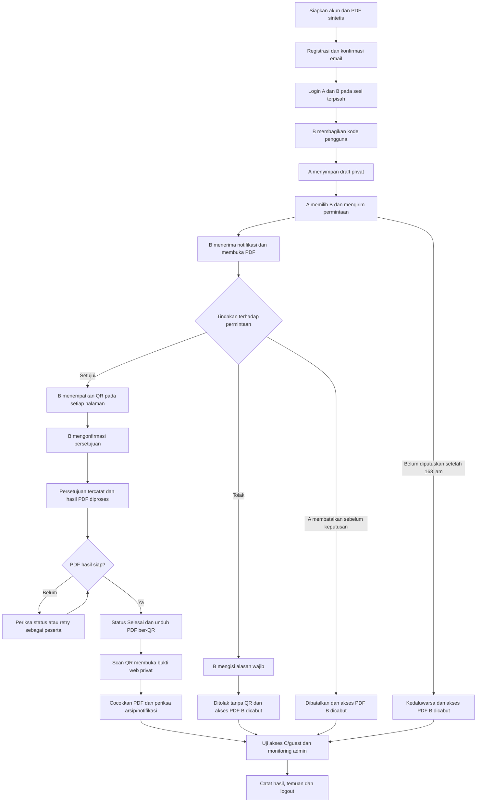

# Alur pengujian manual Document Verification Platform

Disusun **17 November 2026**, zona waktu **Asia/Makassar**. Acuan: source **0.10.1**, termasuk arsip administratif, notifikasi, penghapusan menu Komponen UI dan favicon. Dokumen ini adalah **panduan pengujian/UAT, bukan laporan hasil lulus**. Catat versi atau commit yang benar-benar terpasang pada server pengujian.

Tujuannya membuktikan alur pemilik mengirim PDF kepada satu penerima, penerima mengatur QR dan menyetujui/menolak, serta peserta membaca hasil dan bukti privat. Target tetap prototipe persetujuan internal dengan PDF sintetis. Admin menguji monitoring baca-saja, bukan menjadi reviewer atau penandatangan dokumen pengguna lain.

## 1. Persiapan

| Kebutuhan           | Persiapan penguji                                                                                                                                                                                                 |
| ------------------- | ----------------------------------------------------------------------------------------------------------------------------------------------------------------------------------------------------------------- |
| Lingkungan          | Website lokal atau `https://dvp.ilkomith.cloud` untuk prototipe sintetis. Pastikan source terbaru sudah dibuild dan terpasang, termasuk perubahan ikon/menu.                                                      |
| Akun A — pengirim   | Akun user untuk upload dan mengirim. Bila menguji registrasi, mulai dengan akun baru dan uji pembatasan sebelum konfirmasi email.                                                                                 |
| Akun B — penerima   | User lain dengan email terverifikasi. B membuka Profil dan menyalin kode penggunanya untuk A.                                                                                                                     |
| Akun C — pembanding | User terverifikasi yang tidak dilibatkan dalam permintaan A–B; untuk menguji penolakan akses.                                                                                                                     |
| Akun D — admin      | Akun `platform_admin` terverifikasi yang sudah disiapkan operator. Jangan menjadikan A/B sebagai admin karena admin hanya memakai Admin Workspace. [Panduan admin](signing-revision/r4-cloud-acceptance-plan.md). |
| Sesi terpisah       | Gunakan profil browser berbeda untuk A/B/C/D; dua tab dalam satu profil berbagi sesi. Gunakan jendela tanpa login untuk guest.                                                                                    |
| Dokumen             | PDF sintetis dua halaman, terbaca, tanpa password/data pribadi. Contoh lokal: [fixture dua halaman](../tests/fixtures/signing-r3b-development.pdf).                                                               |
| Cabang keputusan    | Siapkan draft terpisah berjudul `UAT-SETUJU-[RUN]`, `UAT-TOLAK-[RUN]`, `UAT-BATAL-[RUN]`. Jangan mencoba semua keputusan pada satu permintaan terminal.                                                           |
| File pembanding     | Simpan PDF sumber, PDF hasil yang benar-benar diunduh, dan salinan PDF sintetis yang byte/isinya berbeda untuk uji mismatch.                                                                                      |
| Validasi tambahan   | PDF terenkripsi, file non-PDF yang diganti ekstensi menjadi `.pdf`, dan PDF valid yang melebihi batas upload aktif. Default sumber 10 MiB; konfigurasi dapat lebih rendah.                                        |
| Catatan             | Tentukan RUN, penguji, tanggal/jam, browser, perangkat, URL lingkungan, versi/commit dan alias akun. Gunakan [template hasil CSV](template-hasil-pengujian.csv).                                                  |

Gunakan akun/alamat email yang penguji kuasai agar delivery konfirmasi/reset benar-benar dapat diperiksa. Akun `@example.invalid` tidak membuktikan penerimaan email. Hindari mencantumkan alamat email pribadi, password, cookie, token, secret, atau URL konfirmasi/reset pada screenshot/laporan yang dibagikan.

Pembuatan draft dan keputusan manual akan meninggalkan dokumen/riwayat immutable. Tidak ada langkah reset database atau penghapusan riwayat dalam panduan ini. Penyusunan panduan tidak menjalankan pengujian atau membuat akun/dokumen cloud. Runner fixture R1/R2/R3/R3b yang sudah selesai tidak dijalankan ulang.

## 2. Diagram alur utama



Setujui, Tolak, dan Batal memakai **permintaan yang berbeda**. Kedaluwarsa diuji pada undangan milik penguji yang memang sudah melewati waktunya; bukan dengan mempercepat jam komputer atau mengubah timestamp database. Diagram pemrosesan hasil tidak berarti harus menekan retry terus-menerus; tunggu proses yang berjalan dan ikuti status/error yang ditampilkan.

## 3. Urutan praktik untuk satu alur berhasil

| Langkah | Akun    | Tindakan                                                                                                                 | Hasil yang diperiksa                                                                                                     |
| ------- | ------- | ------------------------------------------------------------------------------------------------------------------------ | ------------------------------------------------------------------------------------------------------------------------ |
| 1       | Guest/A | Buka website, periksa favicon, daftar A jika belum ada.                                                                  | Ikon sesuai website; form bekerja; tidak ada pilihan role admin pada registrasi.                                         |
| 2       | A       | Sebelum konfirmasi, coba membuka Buat draft privat. Lalu buka email konfirmasi yang diminta.                             | Pengajuan memerlukan email terverifikasi. Link memakai domain lingkungan yang benar, bukan alamat lokal pada deployment. |
| 3       | A/B     | Selesaikan konfirmasi dan login pada profil browser berbeda.                                                             | User menuju `/dashboard` melalui login biasa tanpa tujuan khusus.                                                        |
| 4       | B       | Buka Profile & Settings, salin kode pengguna dan berikan ke A.                                                           | Kode tampil; kode tersebut bukan tanda tangan atau ID bukti.                                                             |
| 5       | D       | Jika tersedia, catat baseline monitoring sebelum transaksi dokumen.                                                      | Ada waktu snapshot dan angka nyata; catat jika lingkungan dipakai penguji lain.                                          |
| 6       | A       | Buat draft privat, pilih PDF dua halaman, isi judul/kategori, centang consent penyimpanan, klik Simpan draft privat.     | Draft tersimpan; sumber dapat dibaca A; B belum mendapatkan akses atau bukti QR.                                         |
| 7       | A       | Masukkan kode B → Temukan penerima → periksa nama/kode → Gunakan penerima ini → centang izin berbagi → Kirim permintaan. | Satu permintaan Menunggu penerima; penerima dan versi terikat; belum ada bukti persetujuan.                              |
| 8       | B       | Buka lonceng, perbarui bila perlu, lalu buka permintaan masuk.                                                           | Notifikasi milik B membuka permintaan yang sama; PDF sumber dan metadata yang dibagikan dapat dibaca.                    |
| 9       | B       | Pada editor QR, letakkan penanda di halaman 1 dan geser. Pindah ke halaman 2 dan pilih posisi lain.                      | Setujui baru dapat dilanjutkan setelah seluruh halaman memiliki posisi; penanda tidak keluar halaman.                    |
| 10      | B       | Klik Setujui dokumen, periksa judul/versi dan centang consent pada dialog, lalu konfirmasi.                              | Satu persetujuan tercatat. Tidak ada permintaan password/OTP ulang pada kontrak sekarang.                                |
| 11      | A/B     | Buka Buka bukti & PDF hasil dan tunggu hasil siap; gunakan Periksa & siapkan PDF bila memang diperlukan.                 | Status akhir Selesai setelah hasil ready, bukan hanya karena aksi approve tersimpan.                                     |
| 12      | A/B     | Unduh PDF ber-QR, bandingkan kedua halaman dengan sumber dan scan QR.                                                    | Hasil tetap dua halaman, QR sesuai posisi masing-masing, tanpa halaman bukti tambahan; scan membuka bukti di web.        |
| 13      | A/B     | Buka Verifikasi arsip, uji ID/QR dan cocokkan PDF sumber serta PDF hasil.                                                | Bukti privat ditemukan; source/result dibedakan; salinan berbeda menghasilkan tidak cocok.                               |
| 14      | A/B/D   | Periksa notifikasi, Ringkasan arsip, empat tab Dokumen terdahulu dan monitoring D.                                       | Data/status mengikuti transaksi yang berhasil, riwayat lama tetap terpisah, admin hanya melihat agregat.                 |
| 15      | C/Guest | Buka tautan permintaan, bukti dan PDF milik A–B.                                                                         | Guest diminta login; C tidak memperoleh dokumen/bukti walaupun mengetahui URL atau QR.                                   |

Untuk laporan stakeholder, langkah 1–15 adalah demonstrasi alur berhasil. Lengkapi matriks berikut untuk memeriksa cabang gagal dan batas akses; demonstrasi tunggal belum membuktikan seluruh skenario.

## 4. Matriks skenario uji

Prioritas **P0**: akses privat, keputusan final atau integritas hasil; **P1**: fungsi utama; **P2**: tampilan dan kenyamanan. Setiap baris mempunyai catatan hasil tersendiri di CSV.

### A. Tampilan awal, akun dan email

| ID     | Skenario dan langkah                                                                                                     | Hasil yang diharapkan                                                                                                                                                              | Prioritas |
| ------ | ------------------------------------------------------------------------------------------------------------------------ | ---------------------------------------------------------------------------------------------------------------------------------------------------------------------------------- | --------- |
| UAT-01 | Buka login/daftar/lupa password setelah deployment terbaru; periksa tab browser dan Preferensi setelah login.            | Favicon website tampil; menu Komponen UI tidak ada pada Preferensi desktop/mobile.                                                                                                 | P2        |
| UAT-02 | Tanpa login, buka `/dashboard`, `/documents`, `/verify`, dan tautan permintaan/bukti uji.                                | Diminta login; dokumen dan metadata privat tidak ditampilkan kepada guest.                                                                                                         | P0        |
| UAT-03 | Coba registrasi dengan kolom wajib kosong, email tidak valid, atau password yang tidak memenuhi aturan form.             | Validasi jelas; tidak ada konfirmasi akun berhasil untuk input invalid; form tidak menyediakan role admin.                                                                         | P1        |
| UAT-04 | Daftar A bila perlu, lalu coba membuat draft sebelum konfirmasi email.                                                   | Pengajuan dibatasi sampai email terverifikasi; tidak ada PDF/permintaan yang dibuat oleh percobaan terlarang.                                                                      | P0        |
| UAT-05 | Minta konfirmasi akun dan periksa email yang benar-benar diterima.                                                       | Email diterima; lokasi Inbox/Spam dicatat terpisah; tautan memakai origin lingkungan yang benar. Pesan sukses pada form saja bukan bukti delivery.                                 | P1        |
| UAT-06 | Gunakan tautan konfirmasi yang sah, lalu login A/B melalui login biasa tanpa parameter tujuan.                           | Konfirmasi berhasil dan user masuk ke `/dashboard`; nama/akun sesuai sesi.                                                                                                         | P1        |
| UAT-07 | Login dengan password salah; setelah itu login dengan kredensial yang benar.                                             | Percobaan salah ditolak; kredensial benar membuka workspace yang sesuai tanpa memberikan akses admin.                                                                              | P0        |
| UAT-08 | Minta lupa password untuk akun uji milik sendiri; periksa delivery, domain tautan dan autentikasi pengirim pada email.   | Catat Inbox/Spam dan SPF/DKIM/DMARC; link menuju lingkungan yang benar. Jika email masuk Spam, temuan delivery tetap dicatat walaupun link dapat digunakan.                        | P1        |
| UAT-09 | Buka link recovery, simpan password baru, login kembali; coba password lama dan pemakaian ulang link recovery yang sama. | Password baru bekerja; password lama ditolak; link yang sudah dipakai tidak memberi pemulihan baru. Jangan memakai ulang link yang memang belum digunakan untuk menilai kasus ini. | P0        |
| UAT-10 | Ubah nama/telepon akun uji, simpan dan reload; pilih tema terang/gelap/sistem.                                           | Profil sendiri dan pilihan tema tersimpan; email/role tidak dapat diganti melalui form profil tersebut.                                                                            | P1        |

### B. Kode akun, draft dan undangan

| ID     | Skenario dan langkah                                                                                         | Hasil yang diharapkan                                                                                                                | Prioritas |
| ------ | ------------------------------------------------------------------------------------------------------------ | ------------------------------------------------------------------------------------------------------------------------------------ | --------- |
| UAT-11 | A unggah PDF sintetis valid dengan metadata wajib dan consent penyimpanan.                                   | Draft privat tersimpan satu kali untuk satu aksi yang terkonfirmasi; A dapat membuka sumber; belum ada bukti QR.                     | P1        |
| UAT-12 | Coba simpan tanpa file/judul/kategori wajib atau tanpa consent; gunakan form baru tanpa mengirim data valid. | Validasi tampil; draft tidak dibuat sebelum input dan consent memenuhi aturan.                                                       | P1        |
| UAT-13 | Pilih file non-PDF atau file non-PDF yang hanya diubah ekstensi menjadi `.pdf`.                              | Ditolak; mengganti nama file tidak melewati pemeriksaan PDF server.                                                                  | P0        |
| UAT-14 | Pilih PDF valid yang melebihi batas upload aktif, lalu file yang berada dalam batas.                         | File melebihi batas ditolak dengan pesan jelas; file dalam batas tetap harus memenuhi validasi lain. Default maksimum sumber 10 MiB. | P1        |
| UAT-15 | Coba unggah PDF yang terenkripsi atau dilindungi password.                                                   | Ditolak dengan pesan yang menjelaskan file tidak dapat diperiksa; tidak dianggap draft berhasil.                                     | P1        |
| UAT-16 | B buka Profil, salin kode, reload dan salin kembali; bandingkan dengan kode A.                               | Kode akun sendiri stabil, berbeda antar akun, dapat disalin; tidak dipresentasikan sebagai tanda tangan/bukti persetujuan.           | P1        |
| UAT-17 | Pada draft uji A, cari kode sendiri, kode salah/tidak lengkap dan kode yang tidak terdaftar.                 | Tidak dapat mengirim kepada diri sendiri atau penerima invalid; tidak muncul direktori/email pengguna lain.                          | P0        |
| UAT-18 | Cari kode B, periksa hasil; coba melanjutkan sebelum memilih penerima atau sebelum consent berbagi.          | Pengiriman belum dapat dilakukan. Setelah memilih B dan memberi consent eksplisit, tombol Kirim dapat digunakan.                     | P0        |
| UAT-19 | A kirim draft `UAT-SETUJU-[RUN]` kepada B; periksa permintaan terkirim dan sumber versinya.                  | Satu penerima B, status Menunggu penerima, masa undangan 168 jam; penerima/versi tidak dapat diganti dan bukti belum terbit.         | P1        |

### C. Penerima, posisi QR dan persetujuan

| ID     | Skenario dan langkah                                                                                            | Hasil yang diharapkan                                                                                                                          | Prioritas |
| ------ | --------------------------------------------------------------------------------------------------------------- | ---------------------------------------------------------------------------------------------------------------------------------------------- | --------- |
| UAT-20 | Pada sesi B, buka lonceng setelah A mengirim; gunakan Perbarui dan buka item terkait.                           | Notifikasi milik B tersedia dan membuka permintaan yang benar. Upload draft saja tidak wajib membuat notifikasi untuk pemilik.                 | P1        |
| UAT-21 | B buka Permintaan masuk, detail dan PDF sumber; bandingkan judul/versi dengan yang dibagikan A.                 | B dapat preview/unduh versi yang diundang selama aktif; membuka/mengunduh belum mengubah status menjadi disetujui.                             | P0        |
| UAT-22 | Pada PDF dua halaman, atur hanya satu halaman lalu semua halaman; coba drag/keyboard dan posisi berbeda.        | Setujui tidak aktif sebelum penempatan lengkap; posisi dibatasi area halaman dan masing-masing halaman dapat berbeda.                          | P1        |
| UAT-23 | B buka dialog Setujui, coba tanpa consent, lalu centang dan konfirmasi versi yang benar.                        | Consent awal kosong; hanya konfirmasi lengkap yang mencatat persetujuan; sesi yang sah dipakai tanpa password/OTP ulang.                       | P0        |
| UAT-24 | Setelah approve, amati status permintaan dan status proses PDF pada bukti.                                      | Persetujuan dicatat/hasil diproses dipisahkan dari Selesai. Selesai hanya ketika hasil ready; kondisi belum pasti tidak diklaim sukses final.  | P0        |
| UAT-25 | Unduh hasil, periksa jumlah halaman, posisi QR dan bandingkan PDF sumber yang diunduh ulang dengan sumber awal. | Hasil tetap dua halaman dengan QR pada setiap posisi pilihan, tanpa halaman bukti tambahan. Sumber tetap utuh; hash/byte sumber tidak berubah. | P0        |
| UAT-26 | Scan QR dari kedua halaman hasil saat login sebagai A atau B.                                                   | Kedua QR menuju bukti web privat untuk persetujuan yang sama, dengan dokumen/penerima/waktu yang sesuai.                                       | P0        |
| UAT-27 | Sebagai A, buka permintaan yang dikirimnya dan cari tindakan Setujui/Tolak.                                     | Pemilik tidak dapat memberi keputusan sebagai B; mengetahui kode/tautan tidak memberikan hak menandatangani.                                   | P0        |
| UAT-28 | A buka notifikasi tanggapan B, tandai dibaca, reload dan periksa badge.                                         | Tanggapan tersedia bagi A; status dibaca tersimpan dan jumlah mengikuti data akun. Notifikasi approve tidak menjanjikan hasil PDF sudah ready. | P1        |

### D. Penolakan, pembatalan dan kedaluwarsa

| ID     | Skenario dan langkah                                                                                       | Hasil yang diharapkan                                                                                                                                                  | Prioritas |
| ------ | ---------------------------------------------------------------------------------------------------------- | ---------------------------------------------------------------------------------------------------------------------------------------------------------------------- | --------- |
| UAT-29 | A kirim draft baru `UAT-TOLAK-[RUN]`; B buka Tolak dan coba alasan kosong/hanya spasi atau melebihi batas. | Penolakan memerlukan alasan setelah trim, maksimal 1.000 karakter. Input invalid tidak mencatat keputusan.                                                             | P1        |
| UAT-30 | B tolak dengan alasan valid; A periksa riwayat dan notifikasi; B coba akses PDF sumber lagi.               | Status Ditolak, alasan privat bagi peserta, A mendapat tanggapan, tidak ada bukti/PDF ber-QR baru; akses sumber B dicabut. Pemilik tetap mempunyai sumber/riwayat.     | P0        |
| UAT-31 | A kirim draft baru `UAT-BATAL-[RUN]`; buka Batalkan, pilih Kembali, lalu ulangi dan konfirmasi pembatalan. | Kembali tidak mengubah status; konfirmasi menghasilkan Dibatalkan dan notifikasi B. Akses PDF B dicabut, riwayat tetap ada dan undangan tidak bisa diaktifkan kembali. | P0        |
| UAT-32 | Gunakan undangan uji yang memang sudah lewat 168 jam tanpa keputusan; buka sebagai A/B.                    | Tampil Kedaluwarsa; keputusan dan akses PDF B tidak tersedia; sumber A dan riwayat tidak dihapus. Jika belum ada fixture tepat waktu, catat Terblokir, bukan Lulus.    | P0        |

### E. Arsip administratif dan verifikasi privat

| ID     | Skenario dan langkah                                                                                                                                           | Hasil yang diharapkan                                                                                                                                                                                    | Prioritas |
| ------ | -------------------------------------------------------------------------------------------------------------------------------------------------------------- | -------------------------------------------------------------------------------------------------------------------------------------------------------------------------------------------------------- | --------- |
| UAT-33 | A/B buka Ringkasan arsip dan cocokkan dengan aktivitas miliknya selama run.                                                                                    | Angka/daftar sesuai akun. Dokumen saya mencakup draft; metrik selesai/menunggu/ditolak berasal dari permintaan yang dikirim akun, bukan statistik global.                                                | P1        |
| UAT-34 | Buka Dokumen terdahulu; pindah Dokumen saya, Saya kirim, Saya terima dan Pengajuan lama.                                                                       | Data sesuai sumber dan relasi akun; detail signing membuka sumber/permintaan yang benar. Tidak ada data akun lain.                                                                                       | P1        |
| UAT-35 | Cari judul pada Dokumen saya; filter status pada Saya kirim/terima. Jika lebih dari satu halaman, gunakan Berikutnya/Awal daftar.                              | Filter diterapkan pada daftar yang sesuai; status/scope tetap dipertahankan saat pagination; reset membersihkan filter. Jika data kurang, bagian pagination belum terbukti.                              | P1        |
| UAT-36 | Buka Pengajuan lama dan periksa status Selesai/Ditolak/Dibatalkan/Kedaluwarsa pada arah dikirim/diterima; buka Arsip pemeriksaan terdahulu jika ada data lama. | Riwayat persetujuan sekarang dapat dibaca peserta; akun penerima tanpa riwayat terkirim mendapat arah diterima pada halaman awal. Record/status pemeriksaan tetap terpisah di /documents/administrative. | P1        |
| UAT-37 | Pada Verifikasi arsip, masukkan ID/tautan bukti sah; lalu coba kode DVP pengguna dan URL origin lain.                                                          | Bukti peserta sah ditemukan; kode pengguna/URL lain ditolak tanpa membuka tujuan eksternal sebagai bukti aplikasi.                                                                                       | P0        |
| UAT-38 | Pilih gambar QR hasil yang jelas; uji kamera dengan izin lalu hentikan/pindah metode. Coba juga menolak izin kamera.                                           | QR dibaca lokal; stream berhenti saat dihentikan/metode berubah. Penolakan izin menampilkan langkah alternatif gambar/tautan, tanpa membuat persetujuan baru.                                            | P1        |
| UAT-39 | Pilih File PDF pada Verifikasi arsip, gunakan bukti yang sama dan cocokkan sumber lalu hasil yang diunduh.                                                     | Masing-masing dinyatakan cocok sebagai sumber/hasil. Byte PDF pembanding tidak diunggah/disimpan; jika perlu penguji teknis memeriksa request Network.                                                   | P0        |
| UAT-40 | Bandingkan PDF sintetis yang berbeda/diubah menggunakan ID bukti tadi, termasuk file yang ditempeli salinan QR lama.                                           | Hash tidak cocok. Scan QR dapat menunjuk catatan aslinya, tetapi tidak membuktikan file berbeda tersebut disetujui.                                                                                      | P0        |

### F. Batas akses dan keutuhan riwayat

| ID     | Skenario dan langkah                                                                                                                                   | Hasil yang diharapkan                                                                                                                                             | Prioritas |
| ------ | ------------------------------------------------------------------------------------------------------------------------------------------------------ | ----------------------------------------------------------------------------------------------------------------------------------------------------------------- | --------- |
| UAT-41 | Tanpa login, buka tautan PDF sumber/hasil dan API bukti dari dokumen uji A–B.                                                                          | Permintaan API ditolak sebagai guest; tidak ada byte PDF atau DTO privat. Halaman bukti meminta login.                                                            | P0        |
| UAT-42 | Sebagai C, buka URL detail dokumen, permintaan, bukti, PDF sumber dan PDF hasil yang sama.                                                             | Ditolak/tidak ditemukan secara generik; C tidak menerima judul/isi/bukti A–B. Tidak perlu menebak ID dokumen pengguna sungguhan.                                  | P0        |
| UAT-43 | Sebagai A, buka monitoring admin; sebagai D, buka URL User Workspace dan PDF/bukti A–B.                                                                | User tidak mendapat monitoring; D tetap di Admin Workspace dan tidak memperoleh akses isi peserta melalui kewenangan monitoring.                                  | P0        |
| UAT-44 | Setelah keputusan final, reload detail di A/B; periksa apakah penerima, keputusan dan posisi QR masih dapat diubah. Bandingkan sumber/hasil yang sama. | Tidak ada perubahan aksi final/posisi/versi lewat UI; riwayat konsisten dan sumber tidak ditimpa. Refresh biasa tidak membuktikan seluruh kasus idempotensi/race. | P0        |

### G. Monitoring administrator

| ID     | Skenario dan langkah                                                                                       | Hasil yang diharapkan                                                                                                                                                                                   | Prioritas |
| ------ | ---------------------------------------------------------------------------------------------------------- | ------------------------------------------------------------------------------------------------------------------------------------------------------------------------------------------------------- | --------- |
| UAT-45 | Login D dari halaman login biasa tanpa tujuan khusus.                                                      | Otomatis menuju `/admin/overview`; tidak ada perpindahan ke User Workspace; profil sendiri memakai shell admin.                                                                                         | P1        |
| UAT-46 | D muat ulang monitoring sebelum/sesudah transaksi uji dan catat waktu snapshot.                            | Agregat mengikuti transaksi committed. Pada run terisolasi, satu draft menambah dokumen upload; satu request menambah pending; completed bertambah setelah hasil ready dan pending keluar.              | P1        |
| UAT-47 | Bandingkan label aktif 30 hari dengan aktivitas run; lakukan login/reload tanpa aktivitas dokumen.         | Basis aktif adalah akun unik dengan aktivitas dokumen berhasil, bukan jumlah login/reload. A/B yang sudah aktif tidak dihitung ulang; kenaikan pasti memerlukan baseline terkontrol.                    | P1        |
| UAT-48 | Buka Pemantauan hasil PDF; periksa kondisi aktual termasuk kasus gagal/timeout yang tersedia secara alami. | Hanya metadata proses minimum yang disamarkan; tidak ada nama/email pengguna lain, judul/isi PDF atau tautan isi. Kosong sah jika tidak ada kasus; jangan sengaja merusak layanan untuk mengisi daftar. | P0        |
| UAT-49 | Periksa tindakan yang tersedia pada monitoring D dan coba akses halaman permintaan A–B secara langsung.    | Monitoring baca-saja; tidak ada approve/reject/retry atas nama peserta, impersonation atau pengeditan bukti pengguna lain.                                                                              | P0        |

### H. Responsive, pemulihan dan logout

| ID     | Skenario dan langkah                                                                                                                                            | Hasil yang diharapkan                                                                                                                                                                                           | Prioritas |
| ------ | --------------------------------------------------------------------------------------------------------------------------------------------------------------- | --------------------------------------------------------------------------------------------------------------------------------------------------------------------------------------------------------------- | --------- |
| UAT-50 | Ulangi halaman utama pada lebar 1440, 768 dan 390 px dengan mode terang/gelap; gunakan Tab/Enter/Escape pada menu, form dan dialog.                             | Konten dapat dibaca tanpa halaman melebar, fokus terlihat, dialog dapat ditutup, drawer bekerja dan tindakan penting dapat digunakan. Uji drag QR juga dengan sentuhan pada perangkat yang tersedia.            | P2        |
| UAT-51 | Jika ada hasil yang memang pending/gagal, gunakan Periksa & siapkan PDF sebagai peserta. Amati pula error yang muncul selama run tanpa memutus layanan bersama. | Retry tidak membuat keputusan/bukti baru; error tidak menjadi status Selesai atau statistik nol palsu. Bila tidak ada kondisi yang dapat diuji, tandai Tidak berlaku/Terblokir dan jangan klaim recovery lulus. | P0        |
| UAT-52 | Logout A/B/D, lalu reload URL privat/API yang sebelumnya dapat diakses; login C dan buka lonceng/arsip.                                                         | Sesi yang keluar tidak mendapat data lewat request baru; C hanya melihat datanya sendiri, tanpa cache notifikasi/dokumen akun sebelumnya.                                                                       | P0        |

## 5. Catatan hasil yang perlu ditafsirkan dengan benar

**Notifikasi:** transaksi kirim memberi notifikasi kepada B; persetujuan/penolakan memberi tanggapan kepada A; pembatalan memberi notifikasi kepada B. Badge polling sekitar 30 detik saat tab terlihat dan panel tertutup; membuka panel atau Perbarui memuat ulang. Panel terbuka tidak direset timer. Menandai dibaca bukan persetujuan dokumen. Email konfirmasi/reset terpisah dari notifikasi in-app; kirim undangan tidak menjanjikan email/SMS otomatis. [Kontrak notifikasi](in-app-notifications-report.md).

**Status keputusan:** draft → Menunggu penerima → Persetujuan dicatat → Selesai. Persetujuan dicatat dapat berlangsung ketika hasil belum siap. Cabang Ditolak/Dibatalkan/Kedaluwarsa tidak menerbitkan QR persetujuan. Penanda pada editor hanya pratinjau posisi; bukan QR bukti sebelum approve. Hasil R3 lama yang sudah immutable dapat mempunyai halaman bukti tambahan; persyaratan tanpa halaman tambahan diuji memakai persetujuan baru format R3b.

**Email Spam:** pisahkan keberhasilan fungsi tautan dari kualitas pengiriman. Catat Inbox/Spam dan hasil autentikasi pengirim; jangan mengubah hasil menjadi Inbox hanya karena pesan ditandai Bukan spam oleh penguji. SPF/DKIM/DMARC bukan hasil tes dari pesan form. SMTP/DNS berada pada provider; perubahan kode website tidak otomatis memperbaikinya. Jangan berbagi seluruh email recovery atau raw header berisi identitas/token.

**Monitoring:** angka admin mencakup seluruh role dan data development yang masih tercatat, bukan hanya run ini. Catat baseline sebelum/sesudah, waktu snapshot dan aktivitas penguji lain. Aktif 30 hari memakai akun unik dengan upload/kirim/keputusan berhasil. Satu orang melakukan tiga aktivitas tetap satu akun aktif. Jika aktivitas luar run membuat selisih tidak dapat dipastikan, tandai rekonsiliasi agregat Terblokir dan laporkan batas bukti. Jangan membuat angka perkiraan.

**Kasus bersyarat:** email delivery terblokir bila provider/akses inbox belum tersedia. Pagination belum terbukti bila baris tidak melebihi satu halaman. Arsip pemeriksaan terdahulu yang terisi memerlukan akun dengan data legacy miliknya; Pengajuan lama memakai riwayat persetujuan sekarang. Kedaluwarsa memerlukan waktu sebenarnya; recovery render/daftar gagal memerlukan keadaan yang relevan. Jangan menandai kasus ini Lulus hanya karena halaman kosong atau jalur normal berhasil.

## 6. Pencatatan dan penerimaan

Gunakan [template hasil CSV](template-hasil-pengujian.csv). Impor ke Excel/Sheets sebagai UTF-8 dengan pemisah koma. Tersedia **52 skenario**, seluruh status awal **Belum diuji**; isi Hasil aktual, Bukti dan Catatan setelah eksekusi. Gunakan status berikut:

| Status        | Penggunaan                                                                                       |
| ------------- | ------------------------------------------------------------------------------------------------ |
| Belum diuji   | Langkah belum dilakukan.                                                                         |
| Lulus         | Langkah dilakukan dan hasil aktual sesuai seluruh hasil yang diharapkan pada bagian yang diuji.  |
| Gagal         | Hasil aktual bertentangan dengan harapan; sertakan langkah reproduksi dan bukti yang disamarkan. |
| Terblokir     | Prasyarat seperti email, akun admin, waktu kedaluwarsa atau jumlah data belum tersedia.          |
| Tidak berlaku | Kondisi memang tidak termasuk run yang disepakati; tulis alasan dan batas cakupannya.            |

Untuk kasus dengan beberapa sublangkah/perangkat, tulis hasil setiap bagian; jangan menutup kasus Lulus bila ada bagian wajib yang gagal/belum diuji. Tandai Terblokir sampai prasyarat lengkap, atau buat baris lanjutan dengan ID yang sama dan suffix perangkat/subkasus. Catatan Tidak berlaku tidak berubah menjadi bukti lulus.

Header laporan run:

| Field                       | Isian penguji                                                                             |
| --------------------------- | ----------------------------------------------------------------------------------------- |
| RUN / tanggal / waktu       | Isi pada pelaksanaan, gunakan zona waktu yang jelas.                                      |
| Lingkungan / URL / commit   | Catat deployment yang diuji, bukan hanya source lokal terbaru.                            |
| Penguji / akun              | Gunakan nama/alias peran A/B/C/D; simpan kredensial di luar laporan.                      |
| Browser / versi / perangkat | Sertakan viewport atau perangkat fisik untuk uji kamera/sentuhan.                         |
| Cakupan                     | Jalur yang dijalankan dan kasus bersyarat yang dikecualikan.                              |
| Jumlah hasil                | Hitung Lulus/Gagal/Terblokir/Tidak berlaku/Belum diuji dari hasil aktual.                 |
| Data uji tersisa            | Catat judul sintetis dan alias peserta; jangan menghapus record immutable.                |
| Temuan                      | ID kasus, langkah reproduksi, harapan, hasil aktual, prioritas dan bukti yang disamarkan. |
| Kesimpulan / peninjau       | Diterima untuk cakupan prototipe yang diuji atau perlu perbaikan dan retest.              |

Pengujian prototipe diterima untuk cakupan run ketika jalur upload–kirim–approve–PDF–bukti berhasil, kasus P0 yang berlaku telah lulus, tidak ada kegagalan fungsi inti yang belum diselesaikan, dan kasus yang belum terbukti dilaporkan terbuka. Temuan diperbaiki, kasus terkait diulang dan hasil retest dicatat tanpa menghapus bukti gagal sebelumnya.

Panduan ini tidak menutup R5/S-12, membuktikan TTE tersertifikasi atau menyetujui penggunaan dokumen nyata. Build sebelumnya juga melaporkan peringatan keamanan Next.js 16.4.3; catat sebagai temuan dependency terbuka sampai pembaruan dan retest dilakukan. Penerimaan tampilan/favicon atau alur manual tidak menghapus temuan tersebut.

## 7. Pemeriksaan otomatis untuk pengembang

Bagian ini pelengkap UAT; perintahnya **tidak dijalankan saat menyusun panduan ini**. Gunakan Node.js 24 dan dependency proyek yang sudah terpasang:

```bash
npm run lint
npm run typecheck
npm test
npm run test:db
npm run build
npm run test:e2e
npm run test:ui:qr
npm run test:ui:notifications
npm run test:ui:archive
```

Pastikan `DVP_E2E_AUTH_ENABLED` tidak diaktifkan pada regresi browser biasa; pengujian sesi cloud mempunyai opt-in tersendiri. `test:db` memakai PostgreSQL native sementara di loopback, bukan Supabase cloud. `test:e2e` memakai production build lokal; browser Chromium perlu tersedia. Harness UI memakai data sintetis lokal dan tidak membuktikan delivery SMTP, kamera fisik, login peserta atau Storage cloud. Uji unit/SQL mencakup kontrak, RLS, idempotensi dan race yang tidak dibuktikan hanya dengan mengklik UI.

Jangan menjalankan perintah `test:cloud:*`, mengulang migration/seed pada project yang sudah aktif, memberikan role otomatis, atau menghapus receipt lama sebagai bagian dari regresi biasa. [Rencana penerimaan teknis](signing-revision/acceptance-plan.md), [laporan arsip](administrative-archive-report.md), [kontrak QR](signing-revision/qr-placement-contract.md), [kontrak admin](signing-revision/r4-implementation-contract.md), dan [setup autentikasi](authentication-setup.md) memberikan rincian lebih lanjut.
